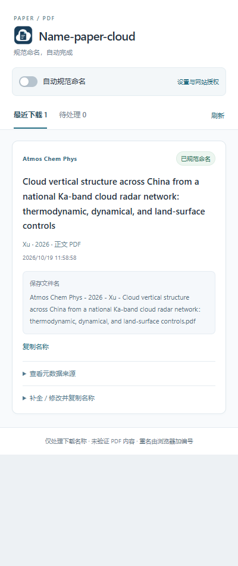
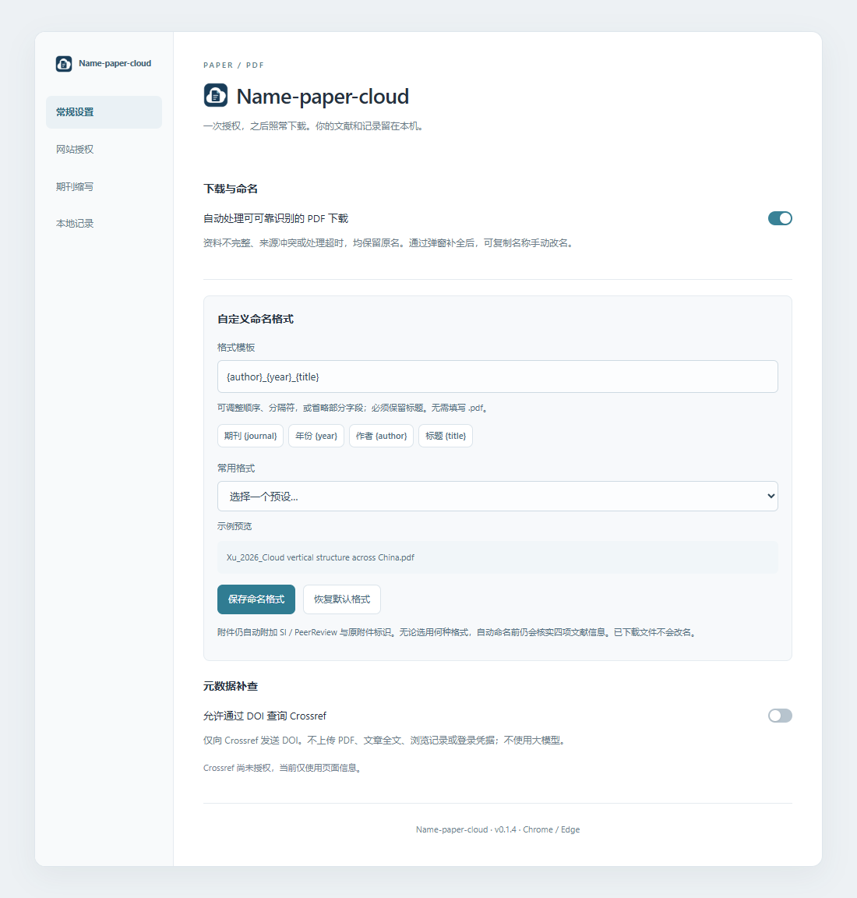
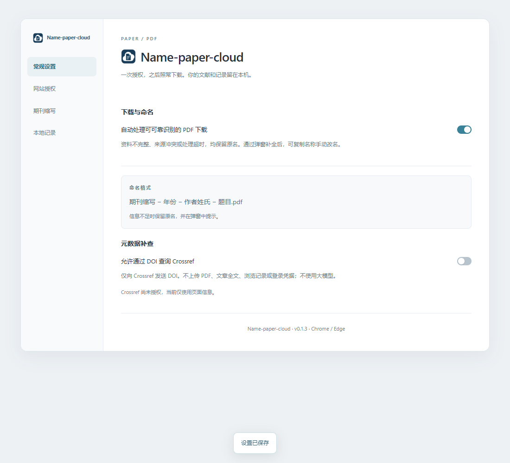

# Name-paper-cloud

**照常下载论文，自动获得清晰、统一的文件名。**

适用于 Windows 上的 Microsoft Edge 和 Google Chrome。安装并授权后，插件会在能够可靠识别论文时，自动将下载的 PDF 命名为：

```text
期刊缩写 - 年份 - 第一作者姓氏 - 题目.pdf
```

信息不足时保留原文件名，并提示你补全。无需安装其他软件。

## 安装：解压 → 加载 → 授权

当前版本 **v0.1.5**，尚未上架扩展商店，需要手动加载一次。

### 第一步：解压安装包

前往 [下载安装包](https://github.com/Jiangshr-mjl/paper-pdf-namer/releases/latest)，下载 `paper-pdf-namer-0.1.5.zip`，解压到一个固定文件夹，例如 `D:\BrowserExtensions\PaperPDF`。

- 解压后应能看到 `manifest.json`、`popup.html`、`icons` 等文件或文件夹。
- 不要直接选择 ZIP 文件，也不要选择包裹在外面的上一级文件夹。
- **安装后请保留这个文件夹，不要移动或删除。** 浏览器需要从这里读取插件。

如果你取得的是 GitHub 的 **Source code / 源码 ZIP**，它不是可直接安装的扩展包，需要先按[开发说明](docs/DEVELOPMENT.md)构建。普通用户请使用 `paper-pdf-namer-版本号.zip` 安装包。

### 第二步：加载到浏览器

| 浏览器 | 在地址栏输入 |
| --- | --- |
| Microsoft Edge | `edge://extensions` |
| Google Chrome | `chrome://extensions` |

1. 打开上面的扩展管理页面。
2. 开启 **“开发者模式”**。
3. 点击 **“加载已解压的扩展程序”**。
4. 选择第一步中包含 `manifest.json` 的文件夹。
5. 在浏览器工具栏的扩展菜单中，将 **“Name-paper-cloud”** 固定或显示到工具栏。

### 第三步：授权需要使用的网站

1. 点击插件图标，打开 **“设置与网站授权”**。
2. 进入 **“网站授权”**，点击 **“授权重点平台与 DOI 补查”**，确认浏览器提示；也可填写网站地址，只授权你需要的网站。
3. 如果只使用 ACP，可直接点击插件弹窗中的 **“授权 ACP”**（尚未授权网站时显示）。
4. **刷新已经打开的论文网页，等待几秒，再下载 PDF。**

> 安装成功不等于已经授权。未授权时，插件无法读取文献信息，会保留原文件名。

## 平时怎么用？

1. 打开论文的文章页面，确认“自动规范命名”已开启。
2. 等待几秒，照常点击网站的 PDF 下载按钮。
3. 下载后点击插件图标，查看“最近下载”中的结果。

| 显示状态 | 含义与下一步 |
| --- | --- |
| 已规范命名 | 下载已完成，浏览器报告的文件名符合建议 |
| 已建议名称 · 下载中 | 已生成名称，等待下载完成 |
| 保留原名 | 信息不够明确；查看原因，必要时手动补全 |
| 请核对名称 | 实际名称与建议不同，请检查下载文件 |
| 下载失败 | 下载未完成，请检查网络或网站后重试 |

“待处理”中集中显示需要补全、核对或下载失败的记录。



*界面截图来自 v0.1.3；图中论文记录来自一次真实 ACP 下载。*

### 信息不全，怎样手动补上？

1. 找到记录，展开 **“补全 / 修改并复制名称”**。
2. 核实并填写期刊缩写、引用年份、第一作者姓氏、原文标题。
3. 选择文件类型；补充材料或审稿文件还需填写原附件标识。
4. 检查预览，勾选字段确认，再点击 **“复制规范名称”**。
5. 到文件管理器中，用复制的名称手动重命名已下载文件。

插件不会因此重复下载、删除或自动改动已有文件。

## 自己设置文件命名格式

打开插件的 **“设置与网站授权” → “常规设置” → “自定义命名格式”**。

1. 选择一个常用格式，或在“格式模板”中输入自己的排列方式。
2. 查看下方即时生成的示例名称。
3. 点击 **“保存命名格式”**，下次下载生效。



| 字段 | 含义 |
| --- | --- |
| `{journal}` | 期刊缩写 |
| `{year}` | 引用年份 |
| `{author}` | 第一作者姓氏 |
| `{title}` | 原文标题，必须保留 |

例如，输入 `{author}_{year}_{title}` 会生成 `Xu_2026_Cloud vertical structure across China.pdf`。也可使用 `{title} [{journal}]` 或仅 `{title}`。

字段按钮可在光标处插入字段。每个字段最多使用一次；`.pdf` 和附件的 `SI / PeerReview` 后缀会自动添加，不用手动输入。点击 **“恢复默认格式”** 可恢复原有规则。

已有文件不会自动改名；弹窗的手动补全预览会使用当前保存的格式。自动命名前仍会核实期刊、年份、姓氏和标题，省略字段不会绕过信息核实。

## 支持哪些论文？

重点适配 **AGU / Wiley、AMS、Copernicus、Nature、PNAS** 的英文期刊页面，但不同页面和下载方式的兼容性可能不同。

- **正文 PDF**：按期刊缩写、年份、第一作者姓氏和标题命名。
- **补充材料**：能明确关联论文时，在名称末尾添加 ` - SI - 附件标识`。
- **审稿 PDF**：能明确关联论文时，添加 ` - PeerReview - 附件标识`。
- **其他文件**：非 PDF 附件保持原名。

ACP 的标准 PDF 直链也可尝试自动命名；其他网站建议先打开文章页。PDF 查看器内置下载按钮、另存为以及部分网站跳转仍需按实际场景确认。

v0.1.5 补充 AMS 同文章路径的 `.xml` 页面与正文下载链接识别。如果旧版提示“未确认正文或附件类型”，更新并重新加载插件后，请刷新文章页再下载。

想先试一次？可以打开这篇已实测的 [ACP 论文页面](https://acp.copernicus.org/articles/26/14303/2026/)，授权并刷新后下载正文。预期名称以 `Atmos Chem Phys - 2026 - Xu - Cloud vertical structure…` 开头。

## 常见问题

### 安装成功了，为什么没有自动改名？

依次检查：

1. 插件的“自动规范命名”开关是否开启。
2. 下载网站是否已获得授权。
3. 授权后是否刷新了文章页，并等待几秒。
4. 弹窗是否提示缺少信息或来源冲突。

信息不足或网络补查未及时完成时，保留原名是正常行为。你可以稍候重新下载，或使用字段补全功能处理已有文件。

### 能整理以前下载的论文吗？

不能扫描或批量整理历史文件夹。插件主要处理新下载；已有记录可以补全信息后复制名称，手动改名。

### 再下载一次，会覆盖原文件吗？

不会。同名文件由浏览器自动加编号。插件不判断两个 PDF 的内容是否相同。

### “已规范命名”是否表示论文内容已经检查？

不是。它表示下载完成后的文件名符合建议，不代表插件验证过 PDF 的页数、首页或内容。

### 怎样添加期刊缩写？

在设置页的 **“期刊缩写”** 中，每行填写一个已核实的映射，再点击 **“保存缩写表”**。例如：

```text
Nature Communications = Nat Commun
```

### 怎样更新插件？

1. 将新版安装包解压，覆盖到**原安装文件夹**。
2. 打开浏览器扩展管理页，点击插件的 **“重新加载”**。
3. 刷新已经打开的文章页。

无需卸载重装，原有设置、授权和记录可继续保留。

## 设置与隐私

设置页可以管理自动命名、网站授权、文献信息补查、期刊缩写和本地记录。



- 只读取你授权的网站。
- 设置和下载记录仅保存在本机，不跨设备同步。
- 最近下载最多保留 100 条，文献信息缓存有效期为 7 天。
- 开启 Crossref 补查后，仅发送论文 DOI 查询信息；不上传 PDF、全文或登录凭据。
- 清除本地记录不会删除下载文件。

## 更多说明

需要查看适配细节、构建方法或测试范围，请阅读[开发说明](docs/DEVELOPMENT.md)和[测试报告](TESTING.md)。
